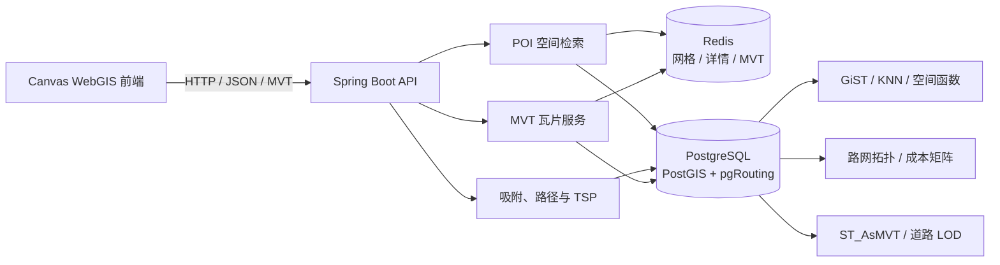

<div align="center">

<h1>🧭 广州市域离线 WebGIS 与路径规划平台</h1>

<p><strong>面向广州市域离线导航与空间信息服务，完整实现从空间数据入库、地图渲染到路径决策的 WebGIS 工程链路。</strong></p>

<p>
  
  
  
  
  
  
  
</p>

<p>
  <a href="#-项目简介">项目简介</a> ·
  <a href="#-核心设计">核心设计</a> ·
  <a href="#-性能实证">性能实证</a> ·
  <a href="#-快速开始">快速开始</a> ·
  <a href="#-项目文档">项目文档</a>
</p>

</div>

---

## 📌 项目简介

`nav-map-sys` 是基于广州 OSM 数据构建的离线空间服务平台。项目以 Spring Boot 为
应用层，以 PostgreSQL/PostGIS 与 pgRouting 为地理计算核心，配套独立的 Canvas WebGIS
前端，提供 POI 空间检索、道路吸附、两点路径、多景点访问顺序优化和 Mapbox Vector
Tile（MVT）服务。

这不是只完成接口联调的课程 Demo：项目覆盖 **广州数据导入、空间索引、路径拓扑、
Redis 空间缓存、道路 LOD、版本化缓存失效、Flyway 演进、真实性能证据和容器化交付**，
重点展示我在 WebGIS 系统设计、空间数据库优化、路径算法工程化和前后端性能治理方面的能力。

> **数据规模**：证据库包含 **628,609 条有效道路边**与 **34,370 条有效 POI**；
> 仓库另保留小规模内置种子，便于评审者一键启动。两种口径在文档中严格区分。

### 我解决的核心问题

| 工程问题 | 解决方案 | 能力体现 |
| --- | --- | --- |
| 大范围路网直接渲染响应慢、体积大 | PostGIS 预聚合道路 LOD + MVT 分级加载 + Redis/HTTP 多级缓存 | 空间数据处理、地图性能优化 |
| 附近/视口查询重复访问数据库 | 固定局部网格缓存候选集，批量回源后执行圆形或矩形精确过滤 | 缓存设计、结果正确性 |
| 任意坐标无法直接参与路由 | GiST/KNN 道路吸附 + `pgr_withPoints` 虚拟点路由 | PostGIS、pgRouting |
| 多景点访问顺序组合爆炸 | 小规模 Held–Karp 精确解，大规模 Nearest Neighbor + 2-opt | 算法选型与复杂度控制 |
| 数据更新后缓存难以一致失效 | 数据版本进入缓存键，事务内递增版本，旧键自然过期 | 一致性设计、工程可靠性 |

## ✨ 已实现能力

- POI 关键字、附近、视口范围和详情查询；
- 基于固定局部网格的 POI 空间缓存；
- 任意局部坐标或 POI 到可通行道路的最近点吸附；
- 步行/驾车、最短距离/最快时间的两点路径规划；
- 多点成本矩阵和最多 50 个停靠点的游览顺序规划；
- Held–Karp 精确 TSP，以及 Nearest Neighbor + 2-opt 启发式优化；
- 局部金字塔坐标系下的单图层和组合 MVT 服务；
- POI 详情、POI 空间网格和 MVT 的 Redis Cache Aside 缓存；
- 数据集版本参与缓存键，实现无扫描、无批量删除的逻辑失效；
- Flyway 管理数据库结构、函数和演示数据初始化；
- Docker Compose 一键启动后端、空间数据库和 Redis。

仓库保留小规模内置种子以便快速初始化；简历与性能报告使用的是完成广州 OSM/POI
导入后的证据库（628,609 条有效道路边、34,370 条有效 POI）。两种数据规模在文档中
明确区分，避免把演示种子数量和广州实测数量混为一谈。

## 🏗️ 系统架构



Maven 工程按职责拆成三个模块：

| 模块 | 职责 |
| --- | --- |
| `nav-pojo` | DTO、VO、PO、路由枚举等跨层数据模型 |
| `nav-common` | 统一响应、异常、常量等公共能力 |
| `nav-server` | Controller、Service、Mapper、缓存、空间计算和应用启动入口 |

`nav-server` 内部继续按业务域划分为 `poi`、`routing`、`map`、`cache`、`version`
等包，避免把空间查询、算法和接口组装混在同一个服务中。

## 🧠 核心设计

### 1. POI 查询与空间网格缓存

POI 模块提供四种读取方式：关键字搜索、附近查询、视口查询和按 ID 获取详情。
关键字查询直接利用数据库筛选；附近查询和视口查询共用同一套空间候选集服务。

空间查询流程如下：

```text
查询范围
  → LocalPoiGridIndex 计算相交网格
  → Redis MGET 批量读取多个网格
  → 合并查询所有未命中网格的整体包围盒
  → 一次访问 PostGIS
  → 按 POI 坐标重新分桶并写回 Redis
  → 合并、按 ID 去重
  → 按圆形或视口精确过滤、排序和 limit
```

网格只负责得到一个不会漏数据的候选集，最终结果仍会按照真实查询形状二次过滤。
因此“附近查询”和“视口查询”可以复用缓存，却不会把矩形包围盒内、圆形半径外的
POI 错误返回。

冷缓存填充使用锁内二次检查，减少页面初始化时多个并发请求重复查询同一片网格。
POI 详情单独缓存，并支持短时间缓存“不存在”的结果，避免无效 ID 持续穿透数据库。
Redis 故障时缓存组件会降级到数据库查询，不影响基础读取能力。

主要入口：

- `GET /api/v1/pois?keyword=...`
- `GET /api/v1/pois/nearby?x=...&y=...&radius=...`
- `GET /api/v1/pois/viewport?viewport=...`
- `GET /api/v1/pois/{id}`

### 2. 道路吸附与两点路径规划

道路吸附负责把 POI 或任意局部坐标转换成路网上可用于计算的位置。PostGIS 先通过
`ST_DWithin` 和 GiST/KNN 索引寻找限定距离内的候选道路，再使用 `ST_ClosestPoint`
与 `ST_LineLocatePoint` 得到吸附坐标、道路 ID 和在线段中的 fraction。

两点路径规划不是简单地把起终点替换成道路端点，而是把两个 fraction 作为虚拟点
交给 `pgr_withPoints`。这样可以从道路中间出发和到达，减少端点替代造成的绕路。
查询完成后，数据库会：

1. 按行驶方向截取首尾道路；
2. 必要时反转几何方向；
3. 按路径顺序拼接 LineString；
4. 汇总局部距离、预计用时和路网版本；
5. 以 WKT 返回路线几何。

当前支持：

- 出行方式：`WALKING`、`DRIVING`；
- 规划策略：`FASTEST`、`SHORTEST`；
- 起终点表达：`poiId` 或局部坐标，两者二选一；
- 单行方向和反向成本：由 `cost`、`reverse_cost` 交给 pgRouting 处理。

主要入口：

- `POST /api/v1/routing/snap`
- `POST /api/v1/routing/routes`

### 3. 多景点游览规划

多点规划将“路网最短路径”和“TSP 访问顺序优化”分成两个阶段：

```text
停靠点
  → 全部吸附到路网
  → pgr_withPointsCostMatrix 计算有向成本矩阵
  → TourOptimizer 选择访问顺序
  → 对相邻访问点逐段查询完整路径几何
  → 汇总顺序、分段、总距离和总时间
```

优化器采用统一接口并由 `TourOptimizerSelector` 选择：

| 算法 | 适用范围 | 特点 |
| --- | --- | --- |
| `HELD_KARP` | 最多 12 个点 | 动态规划求全局最优解，时间和空间复杂度约为 `O(n²·2ⁿ)` |
| `NN_TWO_OPT` | 最多 50 个点 | 最近邻快速构造初始解，再用 2-opt 迭代消除较差路径交叉 |
| `AUTO` | 自动选择 | 12 个点以内使用 Held–Karp，否则使用 NN + 2-opt |

接口同时支持闭环游览、固定起点、开放路径和固定终点。响应中的 `optimal` 会明确表示
当前算法是否保证全局最优，避免把启发式结果误称为精确解。

主要入口：`POST /api/v1/routing/tours`。

### 4. 局部矢量瓦片服务

地图模块在局部平面坐标范围上建立独立的 `z/x/y` 金字塔。数据库函数根据瓦片坐标
反算局部包围盒，使用空间索引筛选要素，再通过 `ST_AsMVTGeom` 和 `ST_AsMVT` 完成
裁剪、量化和 MVT 编码。

接口既可请求单个图层，也可使用 `base` 请求组合底图：

```text
GET /api/v1/map/tiles/{layerCode}/{z}/{x}/{y}.mvt
GET /api/v1/map/tiles/base/{z}/{x}/{y}.mvt
```

生成的二进制瓦片以 `application/vnd.mapbox-vector-tile` 返回。服务端使用 Redis 缓存
MVT 字节，HTTP 响应同时提供浏览器缓存头，使相同数据版本下的瓦片可以在数据库、
服务端和浏览器三个层次复用。

### 5. Redis 缓存与数据版本

缓存键不只包含查询参数，还包含缓存结构版本和业务数据版本，例如：

```text
nav:poi:cell:cs{cacheSchemaVersion}:ds{dataRevision}:z{z}:{x}:{y}
nav:mvt:{layer}:cs{cacheSchemaVersion}:ds{dataRevision}:{z}:{x}:{y}
```

当 POI 或地图数据在同一业务事务中更新时，对应的 `dataset_revision` 同步递增。后续
请求自然使用新版本缓存键，旧缓存等待 TTL 到期即可，不需要执行大范围 `KEYS`、
`SCAN` 或批量删除。这种设计把数据库事务作为数据版本的事实来源，避免“数据库更新
成功但缓存版本没有更新”的双写不一致。

当前数据版本机制主要服务于 POI 和地图瓦片缓存。路由相关 TTL 参数已经预留，但
路径结果尚未作为核心缓存能力写入本项目说明。

### 6. Flyway 数据库初始化

`nav-server/src/main/resources/db/migration` 是数据库结构和初始化快照的权威来源：

- V1～V4：扩展、路网、POI、地图表和数据版本表；
- V5～V8：图层元数据、MVT/导入函数以及旧库兼容修正；
- V9～V11：早期路网、POI 和底图演示数据；
- V12～V18：广州数据模型、Web Mercator 瓦片函数和道路 LOD；
- V19～V25：Geofabrik 底图、低层级聚合、行政面与道路裁剪修正。

Spring Boot 连接空的 `nav` 数据库后自动执行尚未运行的 migration，并通过
`flyway_schema_history` 记录版本和校验和。已经在共享环境执行过的 migration 不应
再修改；后续结构或内置数据变化应继续新增更高版本。

## 📊 性能实证

所有数字均来自固定数据集与本地证据脚本，保留样本数、缓存状态和对照方法；
它们用于说明优化是否有效，不被包装成生产环境容量承诺。

| 场景 | 优化前 / 对照组 | 优化后 | 结果 |
| --- | ---: | ---: | ---: |
| GiST 空间查询（历史稳定样本） | 77.515 ms | 0.056 ms | 查询耗时下降约 **99.93%** |
| 低层级 MVT P50 | 409.46 ms | 2.30 ms | P50 下降约 **99.44%** |
| 低层级 MVT 传输体积 | 原始道路瓦片 | LOD 道路瓦片 | 体积减少 **91.2%** |
| 500 m POI 附近查询 | 数据库 4.99 ms | 热缓存 1.52 ms | 响应时间下降约 **69.5%** |
| 前端固定视口查询（100 次） | 线性扫描约 200 ms | R-tree 约 0.88 ms | 视口检索显著加速 |
| Canvas 地图渲染平均耗时 | 1.35 ms | 0.15 ms | 平均耗时下降约 **88.9%** |

测试覆盖不仅验证 HTTP 状态码，还检查空间结果正确性、缓存命中/失效、数据版本切换、
路径顺序和真实数据库执行计划。当前 Maven 测试共 **45 项**：常规环境执行 40 项通过，
另有 5 项需要广州证据库的性能与执行计划测试；前端测试 **13 项通过**。

复现方式与原始口径见[项目成果与量化实证](docs/project-showcase.md)和
[测试报告](docs/test-report-2026-10-31.md)。

## 🧰 技术栈

- Java 21、Spring Boot 4；
- MyBatis-Plus、MyBatis XML；
- PostgreSQL 17、PostGIS 3.5、pgRouting 3.8；
- Redis、Spring Data Redis；
- Flyway；
- Scalar / OpenAPI；
- Maven 多模块、Docker Compose。

## 🚀 快速开始

Compose 会启动三个容器：

- `postgres`：PostgreSQL 17 + PostGIS 3.5 + pgRouting 3.8；
- `redis`：Redis 持久化缓存；
- `backend`：Java 21 Spring Boot API。

首次启动时 PostgreSQL 镜像创建空的 `nav` 数据库。数据库和 Redis 健康后后端才会
启动，随后 Flyway 自动执行尚未运行的迁移；全新数据库当前会执行至 V25。

### 1. 准备环境变量

如果项目根目录还没有 `.env`：

```powershell
Copy-Item .env.example .env
```

至少修改 `.env` 中的：

```properties
POSTGRES_PASSWORD=请替换成自己的密码
```

Compose 会显式覆盖应用的本地数据库地址，所以 `.env` 中用于本地开发的
`DATABASE_URL=jdbc:postgresql://localhost:5432/nav` 不会传入后端容器。

### 2. 构建并启动

```powershell
docker compose up --build -d
```

首次构建需要下载 Maven、Java、pgRouting 和 Redis 镜像，并执行约 6.6 MB 的种子
迁移，所以会比后续启动慢。

### 3. 查看状态和日志

```powershell
docker compose ps
docker compose logs -f backend
```

默认访问地址：

- API 文档：<http://localhost:8080/scalar>
- OpenAPI JSON：<http://localhost:8080/v3/api-docs>
- PostgreSQL（宿主机调试）：`localhost:5433/nav`
- Redis（宿主机调试）：`localhost:6380`

容器之间不使用宿主机端口：后端通过 `postgres:5432` 和 `redis:6379` 访问依赖。

### 4. 停止和重新启动

```powershell
docker compose stop
docker compose start
```

停止或普通的 `docker compose down` 不会删除命名卷，数据库和 Redis 数据仍然保留。

如果确实要删除所有容器数据并从 V1 重新初始化：

```powershell
docker compose down -v
docker compose up --build -d
```

`down -v` 会永久删除这套 Compose 的 PostgreSQL 和 Redis 卷，只应用于明确需要重置
演示环境的情况。

## 🧪 本地开发与验证

准备 PostgreSQL、PostGIS、pgRouting 和 Redis，并按照 `.env.example` 配置连接信息，
然后执行：

```powershell
mvn test
mvn -pl nav-server -am spring-boot:run
```

前端源码位于独立的 `nav-map-sys-front` 仓库。其 `npm run build` 会执行 TypeScript
检查并将生产产物写入本仓库的 `nav-server/src/main/resources/static`，因此启动后端后
可直接访问 `http://localhost:8080` 查看广州离线导航页面。

当前验证命令：

```powershell
mvn -pl nav-server -am test
powershell -ExecutionPolicy Bypass -File scripts\run_resume_evidence.ps1
```

更详细的数据库迁移约定见
[`nav-server/src/main/resources/db/README.md`](nav-server/src/main/resources/db/README.md)。

## 📚 项目文档

- [文档索引](docs/README.md)
- [后端 API Reference](docs/api-reference.md)
- [后端架构与模块](docs/architecture.md)
- [项目成果与量化实证](docs/project-showcase.md)
- [后端测试报告](docs/test-report-2026-10-31.md)
- [数据库迁移约定](nav-server/src/main/resources/db/README.md)
