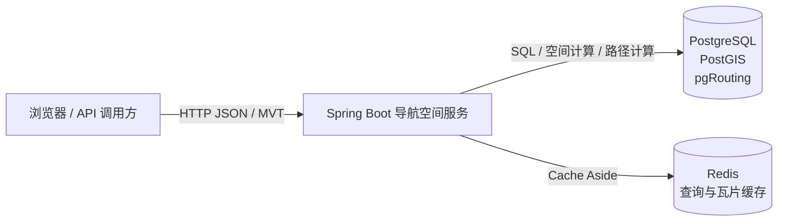
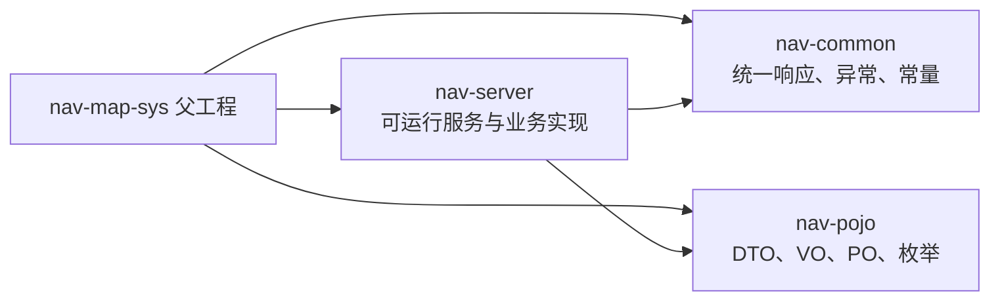
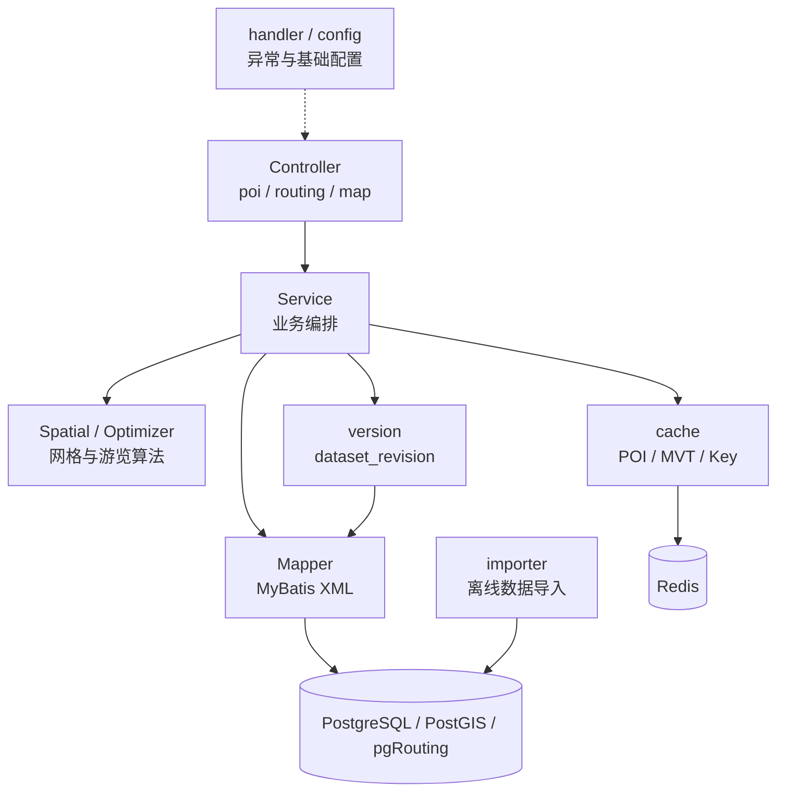
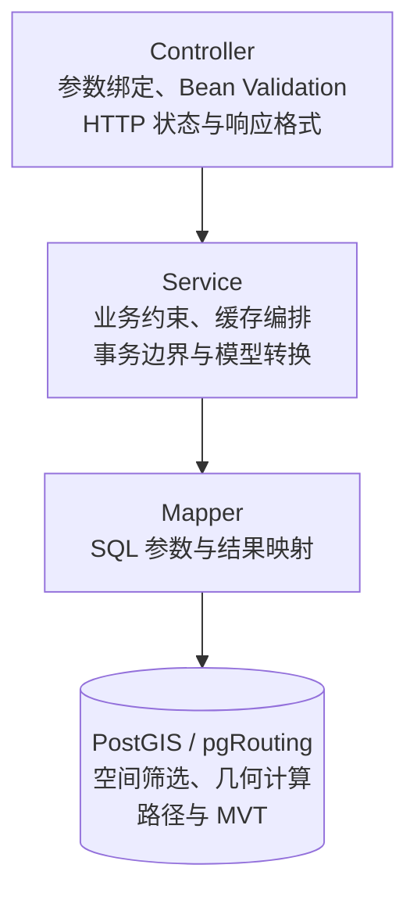
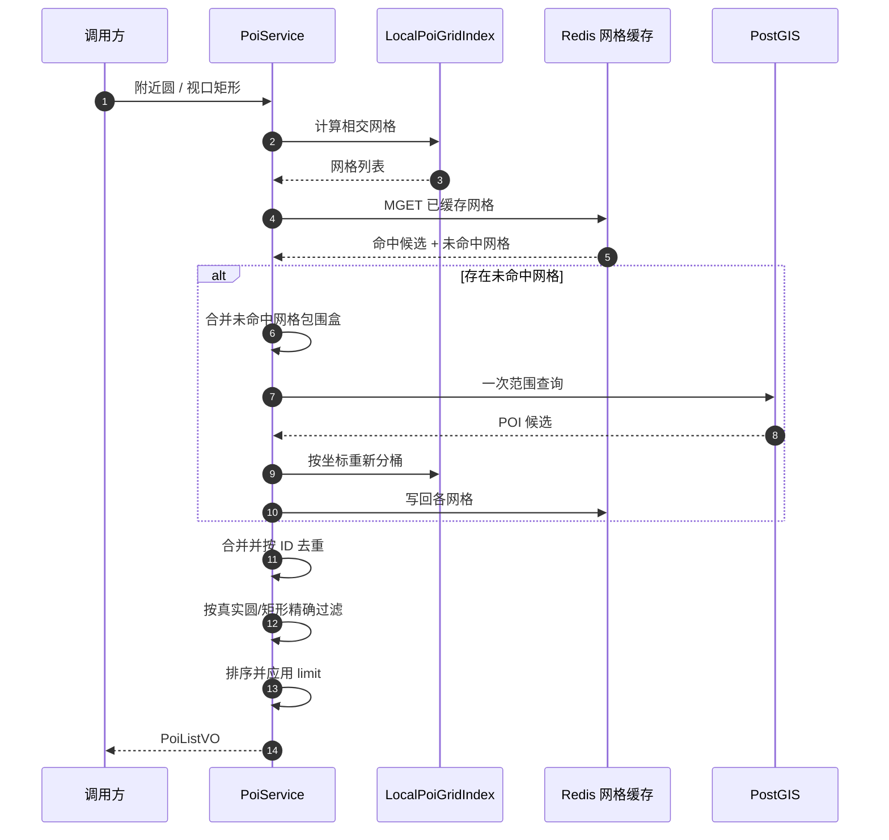
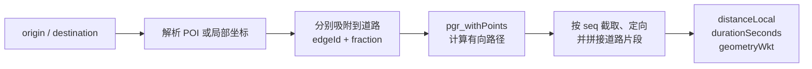
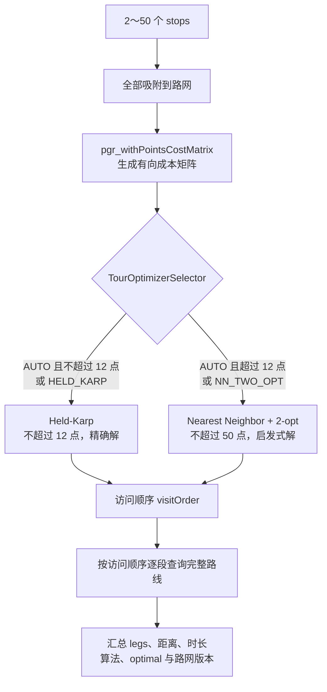
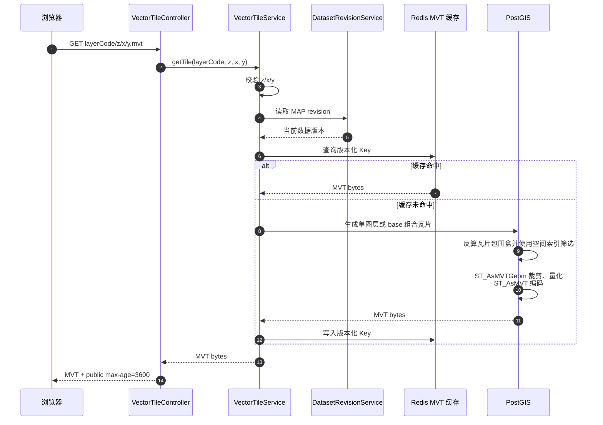
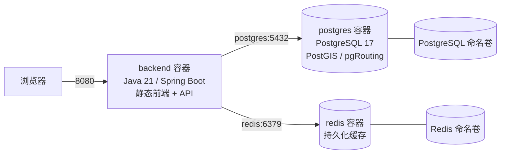

# 后端架构与模块

## 1. 系统上下文



系统面向统一的 Web Mercator（EPSG:3857）平面坐标空间，提供 POI、道路吸附、两点路线、
多点游览和 MVT 服务。应用 DTO 中仍使用 `LocalPoint`/`distanceLocal` 命名，表示服务内部的
统一平面坐标语义；当前广州数据下其距离单位为米。

## 2. Maven 模块

### `nav-pojo`

跨层数据模型：

- `dto`：HTTP 请求和校验约束；
- `vo`：HTTP 响应；
- `po`：持久化对象；
- `enums`：出行方式、路线策略和游览算法。

它不包含 Controller、SQL 或缓存实现。

### `nav-common`

跨业务公共能力：

- `Result<T>` 统一 JSON 包装；
- 业务异常；
- 消息常量。

### `nav-server`

可运行 Spring Boot 应用，包含 Controller、Service、Mapper、缓存、版本、导入、Flyway 和静态前端。



## 3. nav-server 业务模块

### `poi`

- Controller：关键字、附近、视口和详情 API；
- Service：查询编排、精确过滤、排序和 VO 转换；
- Spatial：局部网格划分、候选集合并；
- Mapper：PostGIS 范围和关键字查询。

### `routing`

- RoadSnapService：将 POI/坐标吸附到可通行道路；
- RoutePlanningService：使用 pgr_withPoints 计算两点路线；
- TourPlanningService：成本矩阵、访问顺序优化和分段路线；
- Optimizer：Held-Karp、Nearest Neighbor + 2-opt 及选择器；
- Mapper：PostGIS/pgRouting SQL。

### `map`

- VectorTileController：地图范围和 MVT 响应；
- VectorTileService：图层校验、版本、缓存和生成编排；
- VectorTileMapper：数据库 MVT 函数调用。

### `cache`

- CacheKeyFactory：统一版本化 Key；
- PoiDetailCache：POI 详情和空值短缓存；
- PoiSpatialCache：POI 网格候选；
- VectorTileCache：MVT 字节；
- CacheProperties：TTL、网格和缓存结构版本配置。

缓存是优化层。Redis 故障时，读取流程应降级到数据库而不是改变业务正确性。

### `version`

`dataset_revision` 是数据版本事实来源。Service 读取 POI、路网或地图版本，并把版本带入响应和缓存键。

### `importer`

离线数据导入和预处理入口。导入逻辑必须与 Flyway 中的结构、约束和数据库函数保持一致。

### `handler` 与 `config`

- GlobalExceptionHandler：将业务异常映射为 400/404/500；
- OpenApiConfig：OpenAPI 元数据；
- RedisConfig：缓存序列化及连接配置。



## 4. 请求分层



Controller 不编写 SQL，Mapper 不决定 HTTP 语义，Cache 不成为数据事实来源。

## 5. POI 空间查询与缓存



网格缓存只提供不会漏项的候选集，不代替精确空间谓词。附近查询必须在候选合并后再次检查真实距离。
冷缓存填充在锁内二次检查，减少并发重复访问数据库。

POI 详情采用 Cache Aside；不存在的 ID 可短暂缓存，降低重复穿透。POI 数据版本变化后 Key 自动变化。

## 6. 道路吸附和路线规划

### 道路吸附

1. 将 Waypoint 解析为局部坐标；
2. 按 travelMode 过滤可通行道路；
3. `ST_DWithin` 限定最大距离；
4. GiST/KNN 选择候选；
5. `ST_ClosestPoint` 计算吸附点；
6. `ST_LineLocatePoint` 计算 fraction。

### 两点路线

起终点的 fraction 作为虚拟点传给 `pgr_withPoints`，而不是粗略替换为道路端点。数据库负责方向、
反向成本、首尾道路截取、几何方向调整和 LineString 拼接。



## 7. 多点游览规划



成本矩阵是有向的；2-opt 评估反转片段时必须使用正确方向成本。`optimal` 明确区分精确解和启发式解。

## 8. MVT 服务



`base` 组合多个命名图层到一次 MVT 响应；前端共享一次下载和解码。低层级道路使用离线聚合/预裁剪结果，
高层级逐步恢复详细几何和可见道路。

## 9. 数据版本与缓存一致性

示意 Key：

```text
nav:poi:cell:cs{schema}:ds{revision}:z{z}:{x}:{y}
nav:mvt:{layer}:cs{schema}:ds{revision}:{z}:{x}:{y}
```

数据写事务同步递增相应 `dataset_revision`。请求只使用当前版本 Key，因此无需扫描或批量删除旧缓存。
旧数据自然按 TTL 回收，避免数据库写入成功但缓存删除失败造成的双写窗口。

## 10. 数据库与 Flyway

`nav-server/src/main/resources/db/migration` 是结构、函数和内置数据的权威来源。当前迁移已经演进到 V25，
大体阶段为：

- V1～V4：空间扩展、路网/POI/地图和数据版本基础结构；
- V5～V8：图层元数据、局部地图函数与旧结构修正；
- V9～V11：早期路网、POI 和地图种子；
- V12～V18：广州数据模型、Web Mercator 瓦片函数、道路 LOD；
- V19～V25：Geofabrik 底图、低层级简化/聚合、行政面和道路裁剪修正。

已经执行的版本禁止原地修改。结构、函数、索引和内置数据变化均新增版本。

## 11. 部署结构

Docker Compose 包含：

- `backend`：Java 21 / Spring Boot；
- `postgres`：PostgreSQL + PostGIS + pgRouting；
- `redis`：缓存。



启动顺序由健康检查约束；后端启动时 Flyway 校验并执行未完成迁移。前端生产构建由后端静态目录提供。

## 12. 配置与可观测性边界

配置来自 `application.yaml`、环境变量和 Compose 覆盖。敏感信息只通过环境变量注入，不写入文档或 Git。

建议持续保持这些可观测点：

- HTTP 状态、延迟和异常日志；
- Redis 命中/未命中/降级；
- 数据库连接池、慢 SQL 和 `EXPLAIN (ANALYZE, BUFFERS)`；
- MVT 生成时间和字节大小；
- 路线不可达、吸附失败和游览算法选择；
- 当前 Flyway 与数据版本。

## 13. 模块变更规则

- 新 HTTP 字段：先更新 DTO/VO Schema，再更新 API Reference 和前端类型；
- 新数据库结构：只新增 Flyway migration；
- 新缓存：必须定义事实来源、Key 组成、版本和降级行为；
- 新空间查询：说明坐标、单位、边界语义和索引使用；
- 新业务异常：明确 HTTP 映射并补充错误案例；
- 架构性选择：新增 ADR，避免只在代码注释中记录。

